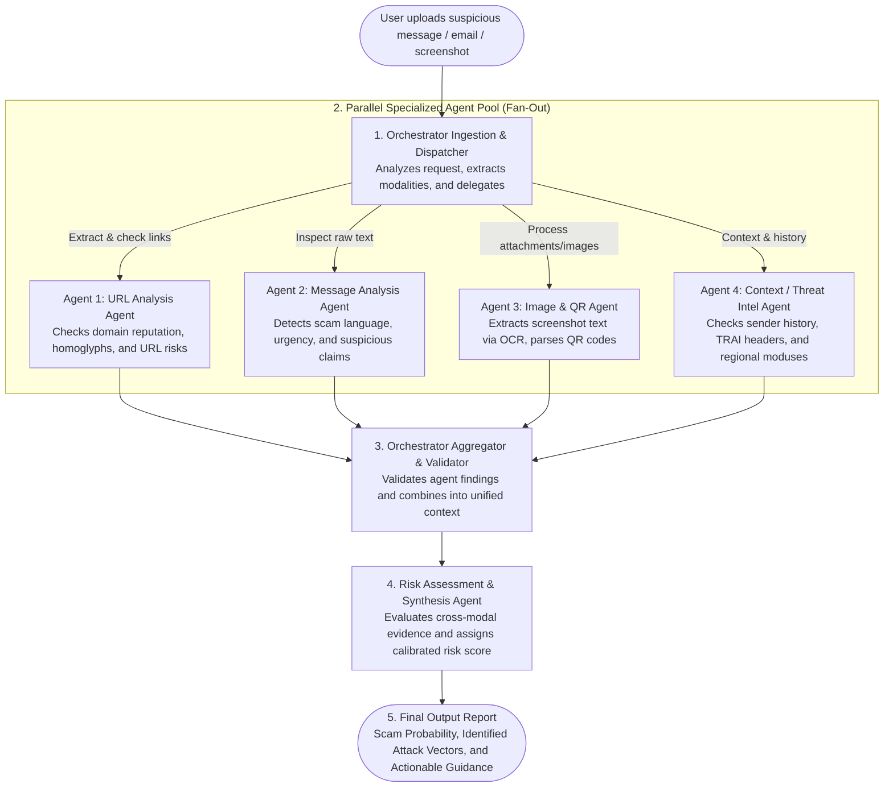
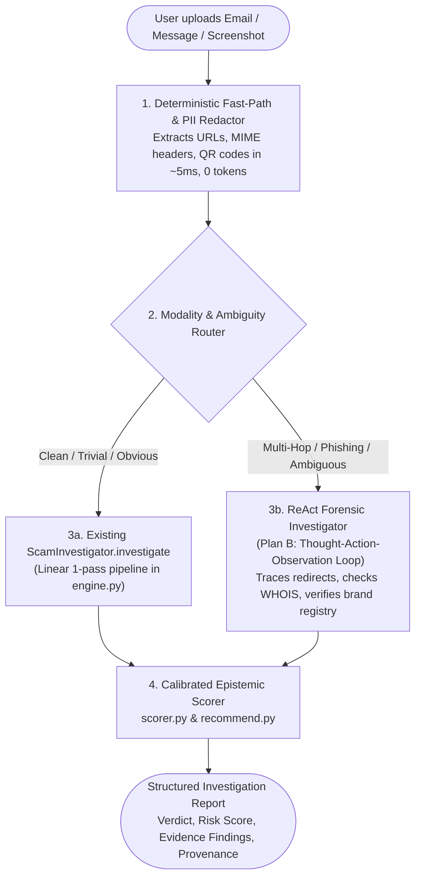

# ScamLens-AI: Agentic AI Architecture & Implementation Blueprints

> **Document Version**: 3.0.0  
> **Status**: Comprehensive Architectural Specification & Comparison (Review Fixes Applied)  
> **Target Module**: `src/scamlens/investigator/agent_workflow.py`  
> **Related Assets**:  
> - Vector Diagram: [`assets/react_cycle_architecture.svg`](../assets/react_cycle_architecture.svg)  
> - Interactive Viewer & PNG Exporter: [`assets/react_cycle_architecture.html`](../assets/react_cycle_architecture.html)  
> - Generator Script: [`scripts/generate_architecture_svg.py`](../scripts/generate_architecture_svg.py)

---

## Executive Overview: Two Agentic Paradigms

ScamLens-AI investigates deceptive messages, emails, and financial fraud. Building an autonomous agentic module can be approached through two distinct paradigms:

```
┌────────────────────────────────────────────────────────────────────────┐
│  Plan A: Hierarchical Multi-Agent (Orchestrator-Worker / Fan-Out)      │
│  • Multiple role-specialized agents (URL, Message, Image, Risk).       │
│  • Parallel execution across input modalities.                         │
│  • Best for: High-throughput multimodal triage of incoming uploads.   │
└────────────────────────────────────────────────────────────────────────┘
                                    vs
┌────────────────────────────────────────────────────────────────────────┐
│  Plan B: Cyclic ReAct Forensic Investigator (Single-Agent + Tools)    │
│  • One unified investigative brain maintaining a hypothesis ledger.    │
│  • Iterative step-by-step tool calling (redirects, WHOIS, DNS, RAG).   │
│  • Best for: Deep multi-hop email/phishing forensic deduction.         │
└────────────────────────────────────────────────────────────────────────┘
```

This document provides complete, production-grade technical blueprints for **both architectures**, followed by an objective **trade-off comparison**, a **Unified Production Hybrid Architecture** (Plan C), and a **Migration & Coexistence Strategy** with the existing `ScamInvestigator` pipeline.

---

## Important: Type Compatibility Notes

ScamLens-AI's core domain models (`EvidenceItem`, `EmailMessage`, `InvestigationResult`, `InvestigationSubmission`) are **plain `@dataclass`** types defined in `src/scamlens/core/models.py` and `src/scamlens/extractors/email.py`. They are **not** Pydantic `BaseModel` subclasses.

LangGraph's recommended state container is `TypedDict`, which works naturally with dataclasses. All state definitions in this plan use `TypedDict` with `Annotated` reducers for LangGraph compatibility:

```python
from typing import Annotated, TypedDict
import operator

# TypedDict works seamlessly with @dataclass members — no serialization mismatch.
class ExampleState(TypedDict):
    evidence: Annotated[list[EvidenceItem], operator.add]  # Reducer: append
```

---

# PLAN A: Hierarchical Multi-Agent Orchestrator-Worker Architecture

### 1. Conceptual Mental Model (Scatter-Gather / Fan-Out Fan-In)

Plan A splits the cognitive workload across **domain-specialized sub-agents**. A central **Orchestrator** inspects the incoming submission, delegates tasks simultaneously to domain specialists, waits for all workers to complete (barrier synchronization), validates outputs, and routes them to a dedicated Risk Assessment Agent.



---

### 2. Specialized Sub-Agent Roles & Specifications

| Agent Name | Primary Mandate | Tools / Capabilities | Output Model |
| :--- | :--- | :--- | :--- |
| **Orchestrator (Dispatcher & Aggregator)** | Decomposes submission into modalities, fans out tasks to active workers, and aggregates results. | Input router, PII sanitizer (`redact_pii`), barrier sync. | `OrchestratorState` |
| **Agent 1: URL Analysis Agent** | Deep-dives into links, shortened URLs, and potential homoglyphs. | `analyze_url` ✅, `check_threat_intelligence` ✅, `trace_redirects` 🔧. | `List[EvidenceItem]` |
| **Agent 2: Message Analysis Agent** | Evaluates NLP indicators: urgency, coercive tone, false authority, bank claims. | `extract_text_indicators` ✅, NLP prompt catalog (`text_triage`). | `List[EvidenceItem]` |
| **Agent 3: Image & QR Agent** | Processes QR code payloads and screenshots (when vision LLM is available). | `decode_qr_payload` ✅, `extract_from_image` ✅ (requires `ai_client`). | `List[EvidenceItem]` |
| **Agent 4: Risk Assessment Agent** | Correlates cross-modal evidence findings and computes calibrated risk. | `calculate_risk_and_verdict` ✅, `generate_recommendations` ✅. | `InvestigationResult` |

> ✅ = Exists in codebase today. 🔧 = To be implemented in Phase 2.

---

### 3. Plan A: LangGraph Implementation Blueprint

In LangGraph, Plan A is implemented using a **Supervisor / Scatter-Gather Graph** pattern:

```python
"""Plan A: Hierarchical Multi-Agent Orchestrator-Worker Implementation."""

from __future__ import annotations

import operator
from typing import Annotated, Any, Dict, List, Optional, TypedDict

from langgraph.graph import StateGraph, END
from scamlens.core.models import (
    EvidenceCategory,
    EvidenceItem,
    IncidentStage,
    InvestigationResult,
    SeverityLevel,
    VerdictEnum,
)
from scamlens.extractors.privacy import redact_pii
from scamlens.extractors.url import analyze_url
from scamlens.extractors.text import extract_text_indicators
from scamlens.extractors.qr import analyze_qr_payload
from scamlens.investigator.scorer import calculate_risk_and_verdict
from scamlens.investigator.recommend import generate_recommendations


# ------------------------------------------------------------------------------
# 1. State Contract for Plan A (TypedDict for LangGraph compatibility)
# ------------------------------------------------------------------------------
class MultiAgentState(TypedDict, total=False):
    # Inputs
    raw_text: str
    urls: list[str]
    image_paths: list[str]
    qr_payloads: list[str]
    incident_stage: IncidentStage

    # Sanitized Context
    sanitized_text: str

    # Fan-In Evidence Ledger (Accumulator via operator.add)
    evidence_ledger: Annotated[list[EvidenceItem], operator.add]

    # Sub-Agent Status Tracking
    completed_agents: Annotated[list[str], operator.add]

    # Final Output
    final_result: Optional[InvestigationResult]


# ------------------------------------------------------------------------------
# 2. Orchestrator Dispatcher Node
# ------------------------------------------------------------------------------
def orchestrator_dispatch_node(state: MultiAgentState) -> Dict[str, Any]:
    """Sanitizes PII and prepares data payloads for parallel sub-agents."""
    cleaned_text, redact_count = redact_pii(state.get("raw_text", ""))
    initial_findings: List[EvidenceItem] = []

    if redact_count > 0:
        initial_findings.append(
            EvidenceItem(
                category=EvidenceCategory.PRIVACY_LEAK,
                severity=SeverityLevel.LOW,
                summary=f"Masked {redact_count} sensitive PII items prior to agent delegation",
                source="orchestrator_privacy_guard",
            )
        )
    return {
        "sanitized_text": cleaned_text,
        "evidence_ledger": initial_findings,
        "completed_agents": ["orchestrator_dispatch"],
    }


# ------------------------------------------------------------------------------
# 3. Domain Worker Nodes (Run in Parallel)
# ------------------------------------------------------------------------------
def url_analysis_agent_node(state: MultiAgentState) -> Dict[str, Any]:
    """Agent 1: Inspects all detected URLs and queries threat intelligence."""
    findings: List[EvidenceItem] = []
    for url in state.get("urls", []):
        findings.extend(analyze_url(url))
    return {
        "evidence_ledger": findings,
        "completed_agents": ["url_analysis_agent"],
    }


def message_analysis_agent_node(state: MultiAgentState) -> Dict[str, Any]:
    """Agent 2: Detects urgency, authority impersonation, and coercive patterns."""
    findings: List[EvidenceItem] = []
    text = state.get("sanitized_text", "")
    if text:
        findings.extend(extract_text_indicators(text))
    return {
        "evidence_ledger": findings,
        "completed_agents": ["message_analysis_agent"],
    }


def image_qr_agent_node(state: MultiAgentState) -> Dict[str, Any]:
    """Agent 3: Analyzes QR code payloads and screenshots (when vision LLM available)."""
    findings: List[EvidenceItem] = []
    # QR payload analysis (deterministic, always available)
    for qr in state.get("qr_payloads", []):
        findings.extend(analyze_qr_payload(qr))
    # Screenshot / image analysis (requires vision LLM — conditionally enabled)
    # TODO Phase 2: Wire up extract_from_image(img_path, ai_client) here.
    #   image_paths = state.get("image_paths", [])
    #   if image_paths:
    #       ai = get_ai_client()
    #       for img_path in image_paths:
    #           findings.extend(extract_from_image(img_path, ai))
    return {
        "evidence_ledger": findings,
        "completed_agents": ["image_qr_agent"],
    }


# ------------------------------------------------------------------------------
# 4. Aggregator & Risk Assessment Node
# ------------------------------------------------------------------------------
def risk_assessment_agent_node(state: MultiAgentState) -> Dict[str, Any]:
    """Agent 4: Correlates combined evidence findings and computes calibrated risk."""
    has_meaningful_content = bool(
        state.get("sanitized_text") or state.get("urls") or
        state.get("image_paths") or state.get("qr_payloads")
    )

    risk_score, confidence, verdict, uncertainties = calculate_risk_and_verdict(
        evidence_items=state.get("evidence_ledger", []),
        has_meaningful_content=has_meaningful_content,
    )

    recommendations = generate_recommendations(
        verdict=verdict,
        stage=state.get("incident_stage", IncidentStage.PRE_ACTION),
        national_helpline="1930 (National Cybercrime Reporting Portal - cybercrime.gov.in)",
    )

    summary = (
        f"Multi-Agent Assessment: {verdict.value.upper()} "
        f"(Risk: {risk_score}/100, Confidence: {int(confidence*100)}%). "
        f"Correlated {len(state.get('evidence_ledger', []))} discrete findings "
        f"across {len(state.get('completed_agents', []))} specialized agents."
    )

    final_res = InvestigationResult(
        verdict=verdict,
        risk_score=risk_score,
        confidence=confidence,
        summary=summary,
        evidence_findings=state.get("evidence_ledger", []),
        uncertainties=uncertainties,
        recommended_actions=recommendations,
        provenance=[{"agent": a} for a in state.get("completed_agents", [])],
    )
    return {"final_result": final_res}


# ------------------------------------------------------------------------------
# 5. Graph Construction
# ------------------------------------------------------------------------------
def build_multi_agent_graph() -> StateGraph:
    """Builds the Plan A Scatter-Gather multi-agent state graph."""
    graph = StateGraph(MultiAgentState)

    graph.add_node("orchestrator", orchestrator_dispatch_node)
    graph.add_node("url_agent", url_analysis_agent_node)
    graph.add_node("message_agent", message_analysis_agent_node)
    graph.add_node("image_qr_agent", image_qr_agent_node)
    graph.add_node("risk_agent", risk_assessment_agent_node)

    graph.set_entry_point("orchestrator")

    # Fan-Out from Orchestrator to all workers simultaneously
    graph.add_edge("orchestrator", "url_agent")
    graph.add_edge("orchestrator", "message_agent")
    graph.add_edge("orchestrator", "image_qr_agent")

    # Fan-In: All workers converge to Risk Assessment Agent
    graph.add_edge("url_agent", "risk_agent")
    graph.add_edge("message_agent", "risk_agent")
    graph.add_edge("image_qr_agent", "risk_agent")

    graph.add_edge("risk_agent", END)
    return graph.compile()
```

---

### 4. Plan A: Strengths & Weaknesses

- **Strengths**:
  - **High Modality Separation**: Each sub-agent can have specialized prompts and distinct model backends (e.g., Vision model for Image Agent, fast 8B model for Message Agent).
  - **Fast Horizontal Concurrency**: When a submission has text, multiple URLs, and images, all 3 workers execute simultaneously.
  - **Intuitive Mental Model**: Easily understood and presented in executive slide decks.
- **Weaknesses**:
  - **Context Siloing**: The URL Agent does not know what brand the Message Agent observed in text; cross-modal brand impersonation is difficult to spot without cross-agent communication.
  - **Token Inefficiency**: Invoking multiple full LLMs for clean, simple inputs creates unnecessary overhead.
  - **No Multi-Hop Depth**: Cannot dynamically follow a redirect chain discovered midway through execution.

---

# PLAN B: Cyclic ReAct Forensic Investigation Architecture

### 1. Conceptual Mental Model (Iterative Hypothesis Loop)

Plan B uses **one central investigator brain** operating in a dynamic **ReAct (Reasoning + Acting)** feedback cycle. Instead of spawning multiple agents, it holds a persistent **Hypothesis Ledger** and calls specific tools from an arsenal one by one as clues emerge.

```mermaid
flowchart TD
    subgraph REACT_ENGINE ["ReAct (Reasoning + Acting) Internal Engine"]
        
        subgraph THOUGHT_PHASE ["1. Thought / Reasoning Phase"]
            T1["State Ingestion: Sanitized Email & Evidence Ledger"] --> T2["Evidence Gap Analysis: Detect Missing or Conflicting Signals"]
            T2 --> T3["Hypothesis Formulation: Rank Active Threat Hypotheses"]
            T3 --> T4{"Termination Check: Hypotheses Resolved or Step Limit Hit?"}
            T4 -->|"Yes (Converged)"| ExitNode["Exit to Epistemic Synthesizer"]
            T4 -->|"No (Pending Evidence)"| T5["Action Selection: Choose Next Tool & Construct Query"]
        end

        subgraph ACTION_PHASE ["2. Action / Tool Dispatch Phase"]
            T5 --> A1["Parameter Validation: Enforce Pydantic Type Invariants"]
            A1 --> A2["Tool Dispatcher: Route to Isolated Security Sandbox"]
            A2 --> A3{"Tool Category"}
            A3 -->|"Headers / Routing"| Tool_DNS["trace_redirects_and_dns / verify_brand_domain"]
            A3 -->|"Threat Intel"| Tool_INTEL["query_threat_intelligence (VT / GSB)"]
            A3 -->|"Payload Analysis"| Tool_ATTACH["inspect_attachment_heuristics / decode_qr"]
            A3 -->|"RAG Advisories"| Tool_RAG["consult_cybercrime_kb (1930 / RBI Advisory)"]
        end

        subgraph OBSERVATION_PHASE ["3. Observation / Telemetry Phase"]
            Tool_DNS --> O1["Normalize Tool Output into EvidenceItem"]
            Tool_INTEL --> O1
            Tool_ATTACH --> O1
            Tool_RAG --> O1
            O1 --> O2["Record Tool Audit Metrics (Latency, Error Status, Raw Response)"]
        end

        subgraph REFLECTION_PHASE ["4. Reflection & State Update Phase"]
            O2 --> R1["Corroboration: Match Observations Against Open Hypotheses"]
            R1 --> R2["Hypothesis State Transition: UNVERIFIED to SUPPORTED or REFUTED"]
            R2 --> R3["Epistemic Calibration: Recalculate Confidence and Unchecked Threat Surface"]
            R3 --> R4["State Reducer: Append to Evidence Ledger & Increment Step Counter"]
            R4 --> T1
        end

    end
```



---

### 2. Mathematical Formulation & Epistemic State Machine

The ReAct agent operates over a dynamic 6-tuple state:

$$S_t = \langle \mathcal{M}, \mathcal{E}_t, \mathcal{H}_t, \mathcal{T}_t, k_t, \mathcal{C}_t \rangle$$

Where:
- $\mathcal{M}$: PII-sanitized email/message context.
- $\mathcal{E}_t$: Evidence Ledger of accumulated verified findings.
- $\mathcal{H}_t$: Active security hypotheses ($h_i \in \{\text{UNVERIFIED}, \text{SUPPORTED}, \text{REFUTED}\}$).
- $\mathcal{T}_t$: Tool execution trace with latency and error statuses.
- $k_t \in [0, K_{\max}]$: Recursion step counter ($K_{\max} = 6$).
- $\mathcal{C}_t \in [0.0, 1.0]$: Calibrated epistemic confidence.

At each step $k$, the agent chooses the action that maximizes information gain on active hypotheses:

$$A_k = \arg\max_{a \in \mathcal{A}} \mathbb{E}\left[\Delta \mathcal{H}(\text{Hypotheses}) \mid a\right]$$

---

### 3. Plan B: Typed Data Contracts & Schemas

```python
"""Plan B: Typed State & Hypothesis Contracts for ReAct Agent."""

from __future__ import annotations

import operator
from dataclasses import dataclass, field as dc_field
from enum import Enum
from typing import Annotated, Any, Dict, List, Optional, TypedDict

from scamlens.core.models import EvidenceItem, IncidentStage, InvestigationResult
from scamlens.extractors.email import EmailMessage


class HypothesisStatus(str, Enum):
    UNVERIFIED = "unverified"
    SUPPORTED = "supported"
    REFUTED = "refuted"


@dataclass
class InvestigationHypothesis:
    """A working security hypothesis evaluated by the agent."""
    id: str            # Unique tag, e.g. "HYP-MALICIOUS-LINK"
    claim: str         # e.g. "Brand impersonation of SBI via unaligned SPF"
    status: HypothesisStatus = HypothesisStatus.UNVERIFIED
    confidence: float = 0.5
    supporting_evidence_ids: List[str] = dc_field(default_factory=list)
    counter_evidence_ids: List[str] = dc_field(default_factory=list)


@dataclass
class ToolCallAudit:
    """Audit record for tool invocation traceability."""
    tool_name: str
    arguments: Dict[str, Any]
    result_summary: str
    execution_time_ms: float
    error: Optional[str] = None

    def to_dict(self) -> Dict[str, Any]:
        return {
            "tool_name": self.tool_name,
            "arguments": self.arguments,
            "result_summary": self.result_summary,
            "execution_time_ms": self.execution_time_ms,
            "error": self.error,
        }


# LangGraph state as TypedDict — compatible with @dataclass members.
class AgentEmailState(TypedDict, total=False):
    # Inputs
    raw_email: EmailMessage
    sanitized_body: str
    incident_stage: IncidentStage

    # Dynamic Evidence & Hypotheses (Annotated reducers for LangGraph)
    evidence_ledger: Annotated[list[EvidenceItem], operator.add]
    hypotheses: list[InvestigationHypothesis]
    audit_trail: Annotated[list[ToolCallAudit], operator.add]

    # Execution Control
    step_count: int
    max_steps: int
    epistemic_uncertainties: list[str]
    requires_human_intervention: bool

    # Final Output
    final_result: Optional[InvestigationResult]
```

---

### 4. Hypothesis → Tool Dispatch Table

The ReAct loop's power comes from mapping **each hypothesis type to a prioritized sequence of verification tools**. The `triage_hypothesis_node` generates hypotheses from email signals; the `execute_tool_node` selects the highest-priority unverified hypothesis and dispatches the right tool.

| Hypothesis ID | Generated When | Verification Tool | Maps to `EvidenceCategory` | Tool Status |
| :--- | :--- | :--- | :--- | :--- |
| `HYP-MALICIOUS-LINK` | Email contains extracted URLs | `analyze_url_structure` → per URL | `URL_DOMAIN` | ✅ Exists |
| `HYP-BRAND-SPOOF` | Sender display name contains known brand but domain doesn't match | `verify_brand_official_domain` | `IMPERSONATION` | ✅ Exists |
| `HYP-THREAT-INTEL` | URLs present but not checked against threat databases | `check_threat_intelligence` | `EXTERNAL_INTEL` | ✅ Exists |
| `HYP-AUTH-FAIL` | SPF/DKIM/DMARC status is `fail` or `softfail` | _(Already resolved by `extract_email_evidence`)_ | `IMPERSONATION` | ✅ Pre-computed |
| `HYP-REPLYTO-DIVERT` | Reply-To domain differs from sender domain | _(Already resolved by `extract_email_evidence`)_ | `IMPERSONATION` | ✅ Pre-computed |
| `HYP-DANGEROUS-ATTACH` | Email has attachments with high-risk extensions | _(Already resolved by `extract_email_evidence`)_ | `EXTERNAL_INTEL` | ✅ Pre-computed |
| `HYP-DOMAIN-AGE` | URL leads to unknown or suspicious domain | `inspect_domain_whois_age` | `EXTERNAL_INTEL` | 🔧 Phase 2 |
| `HYP-REDIRECT-CHAIN` | URL is a known shortener (bit.ly, tinyurl, etc.) | `trace_url_redirects` | `URL_DOMAIN` | 🔧 Phase 2 |
| `HYP-REGIONAL-MODUS` | Text matches known regional scam patterns | `consult_cybercrime_kb` | `EXTERNAL_INTEL` | 🔧 Phase 2 |

> ✅ = Exists in `ToolDispatcher` or `extract_email_evidence` today. 🔧 = To be implemented in Phase 2.

---

### 5. Plan B: LangGraph Implementation Blueprint

```python
"""Plan B: Cyclic ReAct StateGraph Implementation."""

from __future__ import annotations

import time
from typing import Any, Dict, List, Literal

from langgraph.graph import StateGraph, END
from scamlens.ai.tools import ToolDispatcher
from scamlens.core.models import EvidenceCategory, EvidenceItem, SeverityLevel
from scamlens.extractors.email import EmailMessage, extract_email_evidence
from scamlens.extractors.privacy import redact_pii
from scamlens.investigator.recommend import generate_recommendations
from scamlens.investigator.scorer import calculate_risk_and_verdict
from scamlens.rag.knowledge_base import RegionalKnowledgeBase

# Known URL shortener domains that require redirect tracing
_SHORTENER_DOMAINS = {"bit.ly", "tinyurl.com", "t.co", "goo.gl", "ow.ly", "is.gd", "buff.ly"}


# ------------------------------------------------------------------------------
# Node 1: Ingestion & Privacy Sanitization
# ------------------------------------------------------------------------------
def sanitize_email_node(state: AgentEmailState) -> Dict[str, Any]:
    """Strip PII before any LLM or tool sees content."""
    email: EmailMessage = state["raw_email"]
    raw_body = email.body_cleaned or email.body_plain or email.snippet
    cleaned_body, redact_count = redact_pii(raw_body)
    initial_evidence = extract_email_evidence(email)

    if redact_count > 0:
        initial_evidence.append(
            EvidenceItem(
                category=EvidenceCategory.PRIVACY_LEAK,
                severity=SeverityLevel.LOW,
                summary=f"Redacted {redact_count} sensitive PII token(s) prior to agent ingestion",
                source="privacy_guard",
            )
        )
    return {
        "sanitized_body": cleaned_body,
        "evidence_ledger": initial_evidence,
        "step_count": state.get("step_count", 0) + 1,
    }


# ------------------------------------------------------------------------------
# Node 2: Initial Triage & Hypothesis Formulation
# ------------------------------------------------------------------------------
def triage_hypothesis_node(state: AgentEmailState) -> Dict[str, Any]:
    """Inspect email context and formulate testable forensic hypotheses."""
    hypotheses: List[InvestigationHypothesis] = []
    email: EmailMessage = state["raw_email"]
    existing_evidence = state.get("evidence_ledger", [])

    # 1. Reply-To diversion (pre-computed by extract_email_evidence, mark SUPPORTED)
    if email.reply_to_email and email.reply_to_email.lower() != email.sender_email.lower():
        hypotheses.append(InvestigationHypothesis(
            id="HYP-REPLYTO-DIVERT",
            claim=f"Reply-To diversion: replies go to {email.reply_to_email} not {email.sender_email}",
            status=HypothesisStatus.SUPPORTED,
            confidence=0.85,
        ))

    # 2. Auth failures (pre-computed by extract_email_evidence, mark SUPPORTED)
    has_auth_failure = any(
        e.source in ("email_headers_spf", "email_headers_dkim", "email_headers_dmarc")
        for e in existing_evidence
    )
    if has_auth_failure:
        hypotheses.append(InvestigationHypothesis(
            id="HYP-AUTH-FAIL",
            claim=f"Email authentication failure detected (SPF/DKIM/DMARC)",
            status=HypothesisStatus.SUPPORTED,
            confidence=0.90,
        ))

    # 3. Brand impersonation in display name (needs tool verification)
    brand_spoof_evidence = [e for e in existing_evidence if e.source == "email_sender_impersonation"]
    if brand_spoof_evidence:
        hypotheses.append(InvestigationHypothesis(
            id="HYP-BRAND-SPOOF",
            claim=f"Display name impersonates known brand on unverified domain",
            status=HypothesisStatus.UNVERIFIED,
            confidence=0.60,
        ))

    # 4. Suspicious URLs (needs structural analysis + threat intel)
    if email.extracted_urls:
        hypotheses.append(InvestigationHypothesis(
            id="HYP-MALICIOUS-LINK",
            claim=f"Email contains {len(email.extracted_urls)} unverified hyperlink(s)",
            status=HypothesisStatus.UNVERIFIED,
            confidence=0.50,
        ))
        # Check if any URL is a shortener → needs redirect tracing
        from urllib.parse import urlparse
        for url in email.extracted_urls:
            hostname = (urlparse(url).hostname or "").lower()
            if hostname in _SHORTENER_DOMAINS:
                hypotheses.append(InvestigationHypothesis(
                    id="HYP-REDIRECT-CHAIN",
                    claim=f"Shortened URL ({hostname}) hides final destination",
                    status=HypothesisStatus.UNVERIFIED,
                    confidence=0.55,
                ))
                break  # One redirect hypothesis is sufficient

    # 5. Dangerous attachments (pre-computed by extract_email_evidence)
    dangerous_attach = [e for e in existing_evidence if e.source == "email_attachment_analysis"]
    if dangerous_attach:
        hypotheses.append(InvestigationHypothesis(
            id="HYP-DANGEROUS-ATTACH",
            claim=f"Email contains {len(dangerous_attach)} dangerous attachment(s)",
            status=HypothesisStatus.SUPPORTED,
            confidence=0.95,
        ))

    # Post-action emergency
    hitl_flag = state.get("incident_stage", "PRE_ACTION") == IncidentStage.POST_ACTION

    return {
        "hypotheses": hypotheses,
        "requires_human_intervention": hitl_flag,
        "step_count": state.get("step_count", 0) + 1,
    }


# ------------------------------------------------------------------------------
# Node 3: Routing Condition
# ------------------------------------------------------------------------------
def router_condition(state: AgentEmailState) -> Literal["execute_tool", "hitl_gate", "synthesize"]:
    """Conditional edge router evaluating termination conditions."""
    if state.get("requires_human_intervention", False):
        return "hitl_gate"
    unverified = [
        h for h in state.get("hypotheses", [])
        if h.status == HypothesisStatus.UNVERIFIED
    ]
    if unverified and state.get("step_count", 0) < state.get("max_steps", 6):
        return "execute_tool"
    return "synthesize"


# ------------------------------------------------------------------------------
# Node 4: Prioritized Tool Dispatch with Full Hypothesis Coverage
# ------------------------------------------------------------------------------
def execute_tool_node(state: AgentEmailState) -> Dict[str, Any]:
    """Selects the highest-priority unverified hypothesis and dispatches the right tool."""
    dispatcher = ToolDispatcher()
    email: EmailMessage = state["raw_email"]
    new_evidence: List[EvidenceItem] = []
    audits: List[ToolCallAudit] = []
    updated_hypotheses = list(state.get("hypotheses", []))
    uncertainties = list(state.get("epistemic_uncertainties", []))

    # Priority order for tool dispatch
    dispatch_order = [
        "HYP-MALICIOUS-LINK",
        "HYP-BRAND-SPOOF",
        "HYP-REDIRECT-CHAIN",
        "HYP-DOMAIN-AGE",
        "HYP-REGIONAL-MODUS",
    ]

    # Find the first unverified hypothesis in priority order
    target_hyp = None
    for hyp_id in dispatch_order:
        for h in updated_hypotheses:
            if h.id == hyp_id and h.status == HypothesisStatus.UNVERIFIED:
                target_hyp = h
                break
        if target_hyp:
            break

    if target_hyp is None:
        # No actionable hypothesis — mark remaining as uncertainty
        return {
            "hypotheses": updated_hypotheses,
            "audit_trail": audits,
            "step_count": state.get("step_count", 0) + 1,
        }

    # ----- Dispatch based on hypothesis type -----

    if target_hyp.id == "HYP-MALICIOUS-LINK" and email.extracted_urls:
        # Analyze ALL URLs, not just the first
        for url in email.extracted_urls:
            t0 = time.time()
            result = dispatcher.execute_tool("analyze_url_structure", {"url": url})
            elapsed = (time.time() - t0) * 1000
            findings = result.get("findings", [])
            audits.append(ToolCallAudit(
                tool_name="analyze_url_structure",
                arguments={"url": url},
                result_summary=f"{len(findings)} indicator(s) for {url}",
                execution_time_ms=elapsed,
            ))
            # Convert tool findings to EvidenceItems
            for f in findings:
                new_evidence.append(EvidenceItem(
                    category=EvidenceCategory.URL_DOMAIN,
                    severity=SeverityLevel(f.get("severity", "MEDIUM").upper())
                             if f.get("severity") else SeverityLevel.MEDIUM,
                    summary=f.get("summary", "URL analysis finding"),
                    details=f.get("details", ""),
                    is_verified=True,
                    source="analyze_url_structure",
                ))
        # Update hypothesis status
        any_bad = any(e.severity in (SeverityLevel.HIGH, SeverityLevel.CRITICAL) for e in new_evidence)
        target_hyp.status = HypothesisStatus.SUPPORTED if any_bad else HypothesisStatus.REFUTED
        target_hyp.confidence = 0.90 if any_bad else 0.20

    elif target_hyp.id == "HYP-BRAND-SPOOF":
        # Verify sender domain against known brand registry
        rag = RegionalKnowledgeBase()
        # Extract brand hint from existing impersonation evidence
        brand_hint = ""
        for e in state.get("evidence_ledger", []):
            if e.source == "email_sender_impersonation" and "'" in e.summary:
                brand_hint = e.summary.split("'")[1].lower()
                break
        if brand_hint and email.sender_domain:
            t0 = time.time()
            result = dispatcher.execute_tool(
                "verify_brand_official_domain",
                {"brand": brand_hint, "domain": email.sender_domain},
            )
            elapsed = (time.time() - t0) * 1000
            is_official = result.get("is_official", False)
            audits.append(ToolCallAudit(
                tool_name="verify_brand_official_domain",
                arguments={"brand": brand_hint, "domain": email.sender_domain},
                result_summary=f"Official={is_official}",
                execution_time_ms=elapsed,
            ))
            target_hyp.status = HypothesisStatus.REFUTED if is_official else HypothesisStatus.SUPPORTED
            target_hyp.confidence = 0.95 if not is_official else 0.10
        else:
            target_hyp.status = HypothesisStatus.REFUTED
            target_hyp.confidence = 0.30

    elif target_hyp.id == "HYP-REDIRECT-CHAIN":
        # TODO Phase 2: Implement trace_url_redirects tool
        uncertainties.append(
            f"Shortened URL redirect tracing not yet implemented; "
            f"cannot verify terminal destination for shortened links."
        )
        target_hyp.status = HypothesisStatus.SUPPORTED  # Assume risk for unresolvable
        target_hyp.confidence = 0.60

    elif target_hyp.id == "HYP-DOMAIN-AGE":
        # TODO Phase 2: Implement inspect_domain_whois_age tool
        uncertainties.append(
            "WHOIS domain age lookup not yet implemented; "
            "newly registered domains cannot be flagged automatically."
        )
        target_hyp.status = HypothesisStatus.REFUTED  # Cannot confirm
        target_hyp.confidence = 0.30

    elif target_hyp.id == "HYP-REGIONAL-MODUS":
        # TODO Phase 2: Implement consult_cybercrime_kb tool
        uncertainties.append(
            "Regional scam modus knowledge base query not yet implemented."
        )
        target_hyp.status = HypothesisStatus.REFUTED
        target_hyp.confidence = 0.30

    return {
        "evidence_ledger": new_evidence,
        "hypotheses": updated_hypotheses,
        "audit_trail": audits,
        "epistemic_uncertainties": uncertainties,
        "step_count": state.get("step_count", 0) + 1,
    }


# ------------------------------------------------------------------------------
# Node 5: Human-In-The-Loop Interrupt Gate
# ------------------------------------------------------------------------------
def hitl_gate_node(state: AgentEmailState) -> Dict[str, Any]:
    """Interruption checkpoint: Escalates post-action harm scenarios."""
    return {
        "epistemic_uncertainties": state.get("epistemic_uncertainties", []) + [
            "POST_ACTION harm reported; automated action paused for human verification."
        ],
        "step_count": state.get("step_count", 0) + 1,
    }


# ------------------------------------------------------------------------------
# Node 6: Epistemic Calibrator & Synthesizer
# ------------------------------------------------------------------------------
def synthesize_verdict_node(state: AgentEmailState) -> Dict[str, Any]:
    """Computes calibrated risk score, confidence, and verdict from evidence ledger."""
    email: EmailMessage = state["raw_email"]
    has_meaningful_content = bool(
        state.get("sanitized_body") or email.extracted_urls
    )

    risk_score, confidence, verdict, uncertainties = calculate_risk_and_verdict(
        evidence_items=state.get("evidence_ledger", []),
        has_meaningful_content=has_meaningful_content,
    )

    all_uncertainties = list(dict.fromkeys(
        uncertainties + state.get("epistemic_uncertainties", [])
    ))

    incident_stage = state.get("incident_stage", IncidentStage.PRE_ACTION)
    recommendations = generate_recommendations(
        verdict=verdict,
        stage=incident_stage,
        national_helpline="1930",
    )

    step_count = state.get("step_count", 0)
    evidence_ledger = state.get("evidence_ledger", [])
    audit_trail = state.get("audit_trail", [])

    summary = (
        f"ReAct Investigation Complete ({verdict.value.upper()}). "
        f"Risk: {risk_score}/100, Confidence: {int(confidence*100)}%. "
        f"Verified {len(evidence_ledger)} evidence items across {step_count} reasoning cycles."
    )

    final_res = InvestigationResult(
        verdict=verdict,
        risk_score=risk_score,
        confidence=confidence,
        summary=summary,
        evidence_findings=evidence_ledger,
        uncertainties=all_uncertainties,
        recommended_actions=recommendations,
        provenance=[a.to_dict() for a in audit_trail],
    )
    return {"final_result": final_res}


# ------------------------------------------------------------------------------
# Graph Construction & Compilation
# ------------------------------------------------------------------------------
def build_agentic_email_graph() -> StateGraph:
    """Builds and compiles the complete LangGraph email investigation state machine."""
    workflow = StateGraph(AgentEmailState)
    workflow.add_node("sanitize", sanitize_email_node)
    workflow.add_node("triage", triage_hypothesis_node)
    workflow.add_node("execute_tool", execute_tool_node)
    workflow.add_node("hitl_gate", hitl_gate_node)
    workflow.add_node("synthesize", synthesize_verdict_node)

    workflow.set_entry_point("sanitize")
    workflow.add_edge("sanitize", "triage")
    workflow.add_conditional_edges("triage", router_condition, {
        "execute_tool": "execute_tool",
        "hitl_gate": "hitl_gate",
        "synthesize": "synthesize",
    })
    workflow.add_edge("execute_tool", "triage")  # ReAct loop-back
    workflow.add_edge("hitl_gate", "synthesize")
    workflow.add_edge("synthesize", END)
    return workflow.compile()
```

---

### 6. Plan B: Strengths & Weaknesses

- **Strengths**:
  - **Deep Multi-Hop Forensics**: Able to trace chained evidence (Short URL $\rightarrow$ 302 Redirect $\rightarrow$ Terminal Domain $\rightarrow$ WHOIS age $<3$ days $\rightarrow$ RAG Brand mismatch).
  - **Holistic Context**: The agent sees text, headers, and URLs simultaneously, eliminating information silos.
  - **Cost-Efficient**: Only invokes tools when strictly required by unresolved hypotheses.
  - **Strict Epistemic Humility**: Tracks untested attack vectors rather than assuming uninspected components are safe.
- **Weaknesses**:
  - **Sequential Turns**: Steps occur in an iterative loop, which can have higher latency when multiple independent lookups could have run in parallel.
  - **Dynamic Complexity**: Requires careful tuning of stopping conditions to prevent infinite reasoning cycles.

---

# Forensic Tool Arsenal — Availability Matrix

| Tool Identifier (Plan Name) | ToolDispatcher Name | Forensic Capability | Maps to `EvidenceCategory` | Status |
| :--- | :--- | :--- | :--- | :--- |
| `verify_brand_domain` | `verify_brand_official_domain` | Exact & Levenshtein matching against verified RAG bank/gov registry | `IMPERSONATION` | ✅ Exists |
| `analyze_url_structure` | `analyze_url_structure` | Inspect URL for IP hosts, suspicious TLDs, homoglyphs, brand keywords | `URL_DOMAIN` | ✅ Exists |
| `query_threat_intelligence` | `check_threat_intelligence` | Reputation check against VirusTotal & Google Safe Browsing | `EXTERNAL_INTEL` | ✅ Exists |
| `decode_qr_payment` | `decode_qr_payment` | Decode and inspect UPI payment QR payloads | `QR_CODE` / `PAYMENT_UPI` | ✅ Exists |
| `trace_url_redirects` | _(not yet implemented)_ | Follow HTTP 301/302 chains in sandbox to reveal terminal host | `URL_DOMAIN` | 🔧 Phase 2 |
| `inspect_domain_whois_age` | _(not yet implemented)_ | WHOIS/RDAP lookup; flag domains < 30 days old | `EXTERNAL_INTEL` | 🔧 Phase 2 |
| `consult_cybercrime_kb` | _(not yet implemented)_ | Semantic search against 1930 FIR patterns, RBI circulars | `EXTERNAL_INTEL` | 🔧 Phase 2 |
| `inspect_attachment_heuristics` | _(not yet implemented)_ | Magic bytes vs declared MIME type; macro/executable detection | `EXTERNAL_INTEL` | 🔧 Phase 2 |

---

# Side-by-Side Trade-off Comparison Matrix

| Evaluation Dimension | Plan A: Hierarchical Multi-Agent | Plan B: Cyclic ReAct Investigator |
| :--- | :--- | :--- |
| **Primary Architecture** | Supervisor + Worker Agents (Scatter-Gather) | Single-Agent Closed Loop (Thought-Action-Observation) |
| **Execution Pattern** | **Parallel Fan-Out**: Runs URL, Message, and Image agents concurrently. | **Iterative Loop**: Step-by-step tool invocation based on updated hypotheses. |
| **Multi-Hop Investigation** | ❌ **Weak**: Cannot easily pass intermediate tool discoveries between workers. | ✅ **Superior**: Follows dynamic redirect chains, DNS lookups, and WHOIS age. |
| **Cross-Modal Correlation** | ⚠️ **Risk of Siloing**: URL agent lacks message brand context unless passed explicitly. | ✅ **Unified**: Single brain correlates sender display name with link destination. |
| **Token Cost & API Efficiency**| ⚠️ **High**: 4–5 LLM agent prompts per message regardless of content. | ✅ **Optimized**: Only calls LLM tools when hypotheses require verification. |
| **Latency for Multimodal Inputs**| ✅ **Low**: Parallel execution across modalities saves wall-clock time. | ⚠️ **Moderate**: Sequential turns take longer if multiple tool hops are needed. |
| **Risk Scoring Grounding** | Requires careful validation so sub-agents don't hallucinate probabilities. | Fully grounded: Scored deterministically by `scorer.py` from verified findings. |
| **Handling Incomplete Data** | Sub-agents may guess or return empty objects. | Explicit **Epistemic Humility**: Logs `Unchecked Threat Surface`. |
| **Implementation Complexity** | Medium (Multiple agent prompts and fan-in synchronization). | Medium-High (State reducers, conditional edges, recursion guards). |
| **Best-Fit Real-World Use Case**| General multimodal upload triage (User uploads text + image + URL). | Deep Email & Phishing Forensics (MIME headers, redirect chains, attachments). |

---

# PLAN C: The Unified Production Hybrid Architecture (Recommended)

To achieve the best of both worlds, ScamLens-AI adopts a **Unified Hybrid Model**:
1. **Deterministic Pre-Triage (Fast Path)**: Deterministic Python extractors run in parallel (0 tokens, ~5ms) for URLs, headers, and QR codes.
2. **Orchestrator Modality Router**:
   - If evidence is clear-cut (e.g., plain email with zero links or obvious blacklist hit), it skips expensive LLMs and scores immediately via the existing `ScamInvestigator.investigate()` pipeline.
   - If the message contains complex hyperlinks, ambiguous brand claims, or suspicious attachments, it delegates to the **ReAct Forensic Investigator** (`build_agentic_email_graph()`).
3. **Deterministic Epistemic Scoring**: Final verdict and probability are calculated by the calibrated scoring engine (`scorer.py`), not guessed by an LLM.



---

# Migration & Coexistence Strategy

### Current State: `ScamInvestigator` (Linear Pipeline)

The existing [`ScamInvestigator`](../src/scamlens/investigator/engine.py) class already implements a complete linear investigation pipeline:

1. PII redaction (`redact_pii`)
2. Text indicator extraction (`extract_text_indicators`)
3. URL analysis + threat intelligence (`analyze_url`, `check_url_reputation`)
4. QR code payload analysis (`analyze_qr_payload`)
5. Multimodal image/screenshot analysis (`extract_from_image`)
6. Email-specific forensics via `investigate_email()` → `extract_email_evidence()`
7. Calibrated risk scoring + recommendations

This pipeline is consumed by:
- **FastAPI routes**: `api/routes/investigate.py`
- **CLI scanner**: `scripts/scan_gmail.py`
- **Benchmark runner**: `benchmark/runner.py`

### Migration Plan

| Phase | Action | Backward Compatible? |
| :--- | :--- | :--- |
| **Phase 2a** | Create `src/scamlens/investigator/agent_workflow.py` with Plan B's `build_agentic_email_graph()`. It operates alongside `ScamInvestigator` — no existing code is modified. | ✅ Yes |
| **Phase 2b** | Add `investigate_email_agentic()` method to `ScamInvestigator` that wraps the LangGraph invocation, returning the same `InvestigationResult` dataclass. | ✅ Yes |
| **Phase 3** | Add `--agentic` / `--agent-architecture=[linear\|react\|hybrid]` CLI flag to `scripts/scan_gmail.py`. Default remains `linear`. | ✅ Yes |
| **Phase 3b** | Add `?strategy=react` query parameter to FastAPI investigate endpoint. Default remains `linear`. | ✅ Yes |
| **Phase 4** | Benchmark both strategies against PhishBench. If ReAct outperforms on precision/recall without unacceptable latency, switch default to `hybrid`. | ✅ Yes |

### Coexistence Architecture

```python
# In src/scamlens/investigator/engine.py (future addition)
class ScamInvestigator:
    # ... existing methods unchanged ...

    def investigate_email_agentic(
        self,
        email_msg: EmailMessage,
        incident_stage: IncidentStage = IncidentStage.PRE_ACTION,
    ) -> InvestigationResult:
        """Run deep ReAct agentic investigation on a parsed email."""
        from scamlens.investigator.agent_workflow import build_agentic_email_graph
        graph = build_agentic_email_graph()
        result = graph.invoke({
            "raw_email": email_msg,
            "incident_stage": incident_stage,
            "step_count": 0,
            "max_steps": 6,
            "epistemic_uncertainties": [],
            "requires_human_intervention": False,
        })
        return result["final_result"]
```

---

## Implementation Roadmap

- [x] **Phase 1: Architecture Blueprint**: Document Plan A, Plan B, and Hybrid Plan C in `claude/agentic-ai-plan.md`.
- [ ] **Phase 2: Core Graph Implementation**: Implement `src/scamlens/investigator/agent_workflow.py` with Plan B's ReAct graph. Add `investigate_email_agentic()` to `ScamInvestigator`.
- [ ] **Phase 2 (Tools)**: Implement `trace_url_redirects`, `inspect_domain_whois_age`, `consult_cybercrime_kb`, and `inspect_attachment_heuristics` in `ToolDispatcher`.
- [ ] **Phase 3: CLI & API Strategy Switch**: Add `--agent-architecture=[linear|react|hybrid]` to `scripts/scan_gmail.py` and `?strategy=` to FastAPI endpoint.
- [ ] **Phase 4: Empirical Benchmark**: Benchmark against PhishBench to measure precision, recall, latency, and token cost between linear vs ReAct vs hybrid.

---

## Appendix: Review Issue Resolution Log

| Issue # | Description | Resolution |
| :--- | :--- | :--- |
| 1 | `EvidenceItem` is a `@dataclass`, not Pydantic — LangGraph state incompatibility | Switched all state definitions from `BaseModel` to `TypedDict` (LangGraph native) |
| 2 | `EvidenceCategory` enum names don't match codebase | Updated all references to use actual values: `URL_DOMAIN`, `IMPERSONATION`, `EXTERNAL_INTEL`, etc. |
| 3 | `scorer.py` parameter names wrong (`findings`/`has_content`) | Fixed to `evidence_items=` and `has_meaningful_content=`; `generate_recommendations` uses `stage=` and `national_helpline=` |
| 4 | `execute_tool_node` only handles one hypothesis and one URL | Expanded with priority-ordered dispatch table, all-URL iteration, and 9 hypothesis types |
| 5 | Image agent doesn't analyze images | Renamed to "Image & QR Agent" with TODO for `extract_from_image` wiring in Phase 2 |
| 6 | 3 of 6 tools don't exist | Added availability matrix marking ✅ Exists vs 🔧 Phase 2 for every tool |
| 7 | No migration path from existing `ScamInvestigator` | Added full Migration & Coexistence Strategy section with phased rollout |
