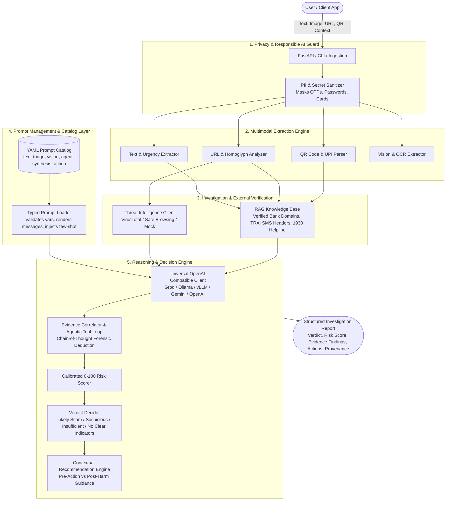

# ScamLens-AI Architecture

ScamLens-AI is an open-source, multimodal AI assistant designed for **evidence-based scam detection, investigation, and response**.

Unlike standard spam classifiers that output a simple binary label (`spam` or `ham`), ScamLens-AI operates as an **investigative decision-support agent**. It correlates multiple pieces of evidence, consults authoritative databases, clearly acknowledges uncertainties, and provides contextual next-step recommendations.

---

## High-Level System Architecture



---

## Prompt Engineering & Management Architecture

ScamLens-AI manages all prompt templates outside of application code using structured **YAML files** stored in `src/scamlens/ai/prompts/catalog/` and loaded dynamically via `src/scamlens/ai/prompts/loader.py`.

### 1. Catalog Structure & Implementation

```
src/scamlens/ai/prompts/
├── __init__.py                                 # Exposes load_prompt & PromptTemplate
├── loader.py                                   # Typed loader, validator & renderer
└── catalog/                                    # Active YAML prompt definitions
    ├── text_triage_v1.yaml                     # SMS/WhatsApp screening (Few-shot)
    ├── vision_screenshot_v1.yaml               # Multimodal screenshot inspection
    ├── investigation_agent_v1.yaml             # Agentic loop & tool selection
    ├── evidence_synthesis_v1.yaml              # Forensic CoT & calibrated scoring
    └── action_guidance_v1.yaml                 # Pre-action vs Post-harm guidance
```

### 2. The 5 Core Prompt Types

| # | Prompt File | Pipeline Role | Primary Technique |
| :--- | :--- | :--- | :--- |
| **1** | `text_triage_v1.yaml` | Rapid screening of incoming SMS/WhatsApp/Hinglish text for suspicious claims, phone numbers, and urgent threats. | **Few-Shot In-Context Learning** |
| **2** | `vision_screenshot_v1.yaml` | OCR extraction, sender badge validation, and visual layout spoof analysis on message screenshots. | **Multimodal Vision Prompting** |
| **3** | `investigation_agent_v1.yaml` | System prompt driving the tool-calling loop (`run_agent_loop`), directing tool selection (RAG lookup, URL parser, threat check). | **ReAct / Tool Schema Calling** |
| **4** | `evidence_synthesis_v1.yaml` | Forensic correlation of multimodal findings, scoring calibration (0–100), and reporting unresolved uncertainties. | **Chain-of-Thought (CoT) & JSON Mode** |
| **5** | `action_guidance_v1.yaml` | Contextual action generator tailoring advice for pre-action prevention vs urgent post-harm response. | **Conditional Guardrail Prompting** |

### 3. Prompt Engineering Techniques Applied

1. **Few-Shot In-Context Learning**:
   - Calibrates the LLM for regional Indian fraud tropes (e.g. reverse UPI requests where victims are told to enter their UPI PIN to *receive* money, and colloquial Hinglish urgency like *"bijli cut ho jayegi"*).
   - Includes balanced pairs: benign transactional alerts, phishing links, reverse-payment lures, and ambiguous messages.
2. **Chain-of-Thought (CoT) Forensic Reasoning**:
   - In `evidence_synthesis_v1.yaml`, the model must execute step-by-step reasoning inside a `thought_process` object before generating scores:
     1. *Claim Analysis*: What is being promised or threatened?
     2. *Domain Cross-Verification*: Does the domain match the official registry?
     3. *Policy Inconsistency*: Does legitimate organization practice contradict the claim?
     4. *Explicit Uncertainties*: What critical information is missing or unverified?
3. **Epistemic Guardrails & Explicit Uncertainty (README §6, §11)**:
   - *Absence of threat records != Safety*: Threat lists cannot guarantee that a new site is benign.
   - *Appropriate Abstention*: Ambiguous or empty inputs must return `Insufficient evidence`.
   - *Credential Safeguards*: The assistant never asks the user for real OTPs, passwords, or PINs.
4. **Strict JSON Schema Enforcement**:
   - All analytical prompts enforce JSON mode (`response_format: {"type": "json_object"}`) to guarantee strict alignment with domain contracts (`InvestigationResult`).

### 4. Developer Interface

```python
from scamlens.ai import get_ai_client, load_prompt

prompt = load_prompt("text_triage_v1")
messages = prompt.render_messages(text="Dear user, account blocked. Update KYC at http://fake.xyz")

client = get_ai_client()
result = client.chat_completion(
    messages=messages,
    temperature=prompt.model_parameters.get("temperature", 0.0),
)
```

---

## Core Pillars & Principles (README §4, §6, §11)

1. **Evidence Before Confidence**: No verdict is declared on gut-feeling LLM confidence alone; every claim must cite an extracted indicator or verified external record.
2. **Explicit Uncertainty**: If a domain has no record on threat lists, ScamLens explicitly notes that *absence of warning does not equal proof of safety*. If evidence is missing, it returns `Insufficient evidence`.
3. **Privacy by Design**: Sensitive user secrets (OTPs, passwords, full card numbers) are redacted at ingestion before entering any reasoning pipeline or log.
4. **Actionable Recommendations**:
   - **Pre-Action**: Prevents harm by advising independent verification channels and warning against credential disclosure.
   - **Post-Action**: If the user already lost funds or entered credentials, provides urgent emergency mitigation (freeze transactions via national cybercrime helpline `1930`, file report on `cybercrime.gov.in`, preserve chats/screenshots).

---

## Evaluation Benchmark (README §9, §10)

Evaluation is performed via `benchmark/runner.py` across diverse scenarios:
- Benign transactional messages
- Brand impersonation (e.g. SBI, HDFC)
- UPI Payment QR scams (misuse of `upi://pay` links to induce payment)
- Low-information / ambiguous cases
- Post-incident harm mitigation
