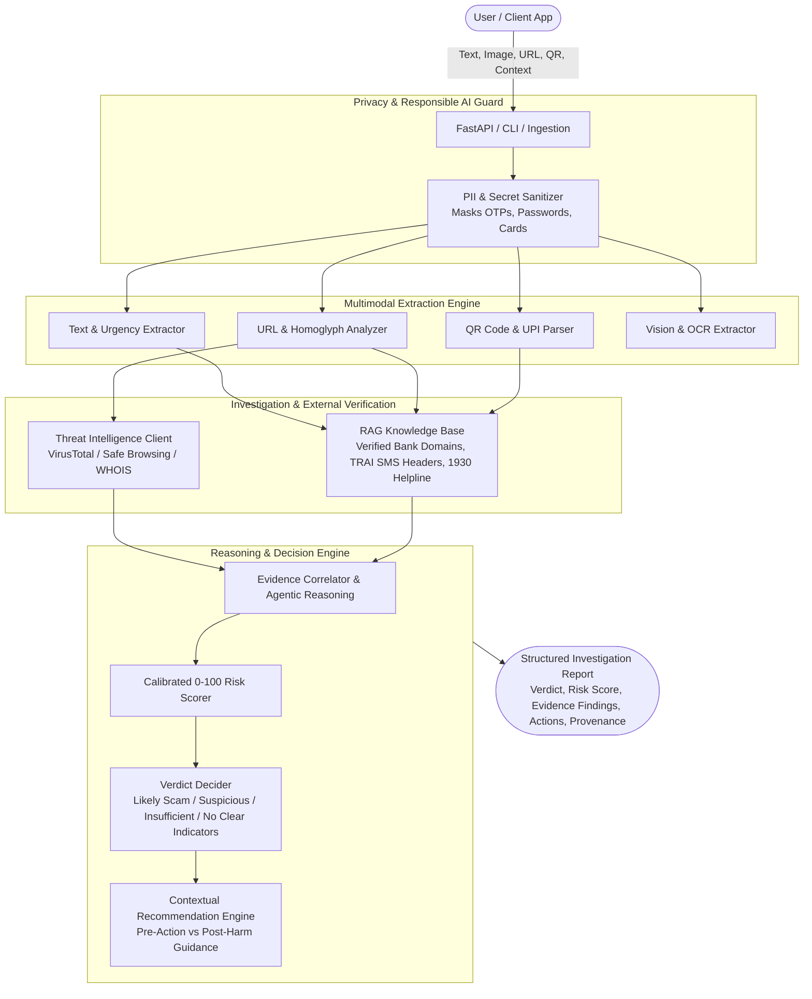

# ScamLens-AI Architecture

ScamLens-AI is an open-source, multimodal AI assistant designed for **evidence-based scam detection, investigation, and response**.

Unlike standard spam classifiers that output a simple binary label (`spam` or `ham`), ScamLens-AI operates as an **investigative decision-support agent**. It correlates multiple pieces of evidence, consults authoritative databases, clearly acknowledges uncertainties, and provides contextual next-step recommendations.

---

## High-Level System Architecture

---

## Core Pillars & Principles (README §4, §6, §11)

1. **Evidence Before Confidence**: No verdict is declared on gut-feeling LLM confidence alone; every claim must cite an extracted indicator or verified external record.
2. **Explicit Uncertainty**: If a domain has no record on threat lists, ScamLens explicitly notes that *absence of warning does not equal proof of safety*. If evidence is missing, it returns `Insufficient evidence`.
3. **Privacy by Design**: Sensitive user secrets (OTPs, passwords, full card numbers) are redacted at ingestion before entering any reasoning pipeline or log.
4. **Actionable Recommendations**:
   - **Pre-Action**: Prevents harm by advising independent verification channels and warning against credential disclosure.
   - **Post-Action**: If the user already lost funds or entered credentials, provides urgent emergency mitigation (freeze transactions via national cybercrime helpline `1930`, file report on `cybercrime.gov.in`, preserve chats/screenshots).

---

## Evaluation Benchmark (README §9, §10)

Evaluation is performed via `benchmark/runner.py` across diverse scenarios:
- Benign transactional messages
- Brand impersonation (e.g. SBI, HDFC)
- UPI Payment QR scams (misuse of `upi://pay` links to induce payment)
- Low-information / ambiguous cases
- Post-incident harm mitigation

